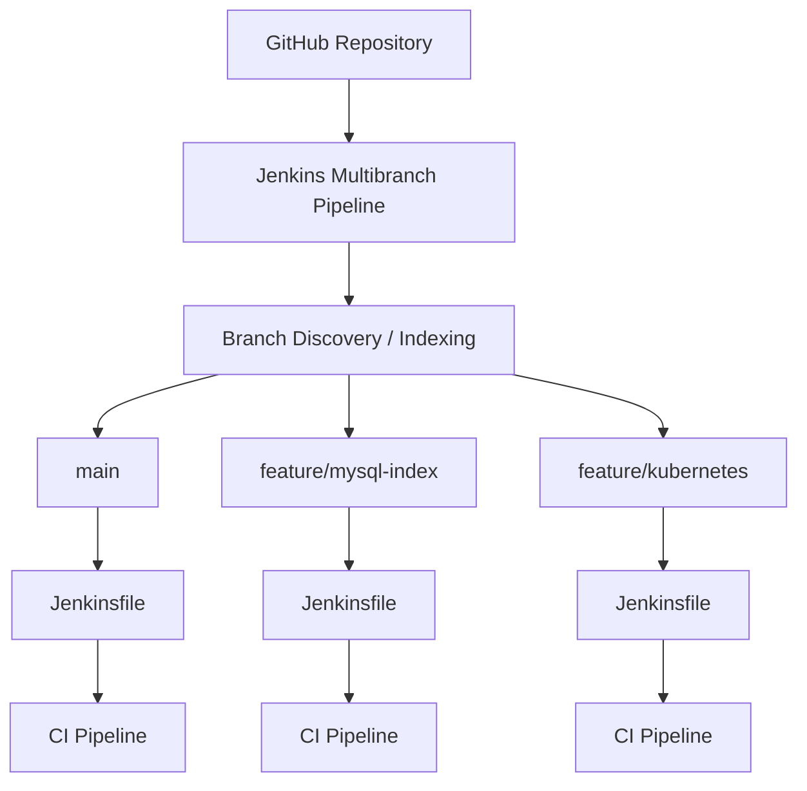
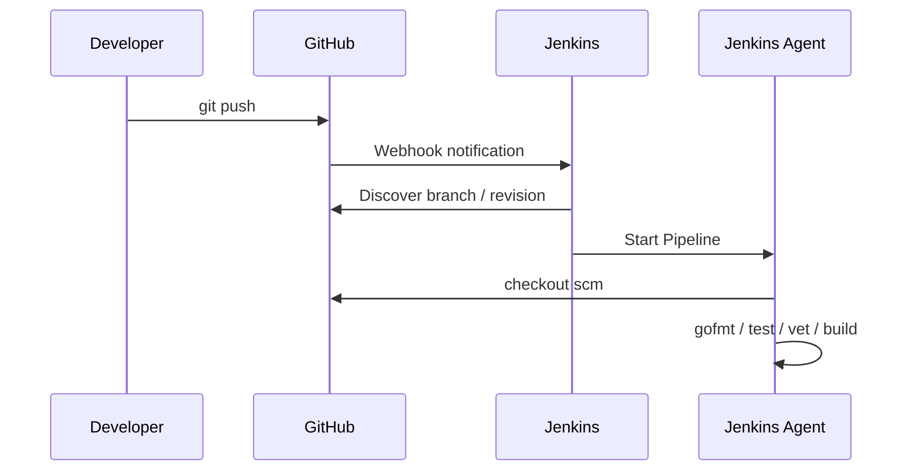
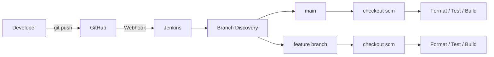

# Jenkins Multibranch Pipeline

This document summarizes the basic concepts behind Jenkins Multibranch Pipelines, including:

- branch discovery
- branch-specific Pipelines
- credentials
- webhooks
- `BRANCH_NAME`
- `checkout scm`

---

# Why Multibranch Pipeline?

A normal Pipeline typically represents one Jenkins job.

A Multibranch Pipeline allows Jenkins to discover multiple branches from the same repository and manage a Pipeline for each relevant branch.

Conceptually:

```text
Git Repository
│
├── main
├── feature/mysql-index
├── feature/kubernetes
└── bugfix/api-error
```

becomes:

```text
Jenkins Multibranch Pipeline
│
├── main
├── feature/mysql-index
├── feature/kubernetes
└── bugfix/api-error
```

Each discovered branch can run the `Jenkinsfile` stored in that branch.

---

# Overall Architecture



The basic flow is:

```text
Repository
↓
Branch Discovery
↓
Find branches containing Jenkinsfile
↓
Create / update branch jobs
↓
Run Jenkinsfile for each branch
```

---

# Branch Discovery

Branch Discovery tells Jenkins which branches or change requests should become Pipeline jobs.

Conceptually:

```text
Repository
│
├── main
│   └── Jenkinsfile
│
├── feature/a
│   └── Jenkinsfile
│
└── experiment
```

Jenkins scans the repository.

It discovers:

```text
main
feature/a
```

because those branches contain a usable `Jenkinsfile`.

The Multibranch Pipeline then manages separate child jobs for those branches.

---

# Branch Indexing

Branch discovery happens during repository scanning or indexing.

Conceptually:

```text
Scan Repository
↓
Find branches
↓
Check Jenkinsfile
↓
Create / update Jenkins branch jobs
```

For example:

```text
new branch pushed
↓
feature/mysql-index
↓
Jenkins detects branch
↓
finds Jenkinsfile
↓
creates branch Pipeline
```

Branch indexing is therefore different from actually running the build.

```text
Indexing
→ discover what should be built

Build
→ execute the Jenkinsfile
```

---

# `BRANCH_NAME`

Multibranch Pipeline exposes the current branch through:

```groovy
env.BRANCH_NAME
```

Example:

```groovy
echo "Branch: ${env.BRANCH_NAME}"
```

Possible output:

```text
Branch: main
```

or:

```text
Branch: feature/mysql-index
```

This allows branch-specific Pipeline behavior.

---

# Conditional Branch Execution

Example:

```groovy
stage('Main Branch Check') {
    when {
        branch 'main'
    }

    steps {
        echo 'Running main-branch checks'
    }
}
```

Conceptually:

```text
Current branch
      │
      ▼
Is branch main?
   /       \
 yes        no
 │           │
 ▼           ▼
run        skip
stage      stage
```

This is useful when some operations should only happen from a specific branch.

For example:

```text
feature branch
→ build + test

main
→ build + test + additional validation
```

A future CD Pipeline could use the same idea:

```text
feature/*
→ CI only

main
→ CI + deployment
```

---

# `checkout scm`

In a Multibranch Pipeline:

```groovy
checkout scm
```

checks out the SCM revision associated with the current Pipeline execution.

Conceptually:

```text
Jenkins discovers:
feature/mysql-index
        ↓
runs branch Pipeline
        ↓
checkout scm
        ↓
checkout feature/mysql-index revision
```

This is preferred over manually hard-coding:

```text
main
```

because a Multibranch Pipeline needs to work with different branches and pull requests.

---

# Credentials

Jenkins may require credentials to access the source-code management system.

Two useful concepts are:

```text
Scan Credentials
```

and:

```text
Checkout Credentials
```

## Scan Credentials

Used when Jenkins needs to communicate with the SCM provider API.

Example responsibilities:

```text
discover repositories
discover branches
discover pull requests
read repository metadata
manage webhooks when permitted
```

Conceptually:

```text
Jenkins
↓
Scan Credentials
↓
GitHub API
↓
discover branches / PRs
```

## Checkout Credentials

Used to actually clone or fetch repository contents.

Conceptually:

```text
Jenkins Agent
↓
Checkout Credentials
↓
git clone / checkout
↓
workspace
```

The distinction is:

```text
Scan credentials
→ discover metadata

Checkout credentials
→ retrieve source code
```

Depending on the Jenkins SCM plugin configuration, the same credential may sometimes be used for both purposes.

---

# Credentials Must Not Be Committed

Credentials should not be stored directly in:

```text
Jenkinsfile
Git repository
README
.env committed to Git
```

Do not write:

```groovy
environment {
    GITHUB_TOKEN = 'real-secret-token'
}
```

Instead, credentials should be stored and managed by Jenkins.

Conceptually:

```text
Jenkins Credentials Store
↓
credential ID
↓
Pipeline / SCM configuration
```

The repository stores the Pipeline logic, not the actual secret.

---

# Webhook

A webhook allows the SCM provider to notify Jenkins when an event occurs.

Without a webhook, Jenkins may need to repeatedly poll or periodically scan the repository.

Conceptually:

```text
GitHub
↓
push / PR event
↓
Webhook
↓
Jenkins
↓
branch indexing / build trigger
```

Important:

```text
Webhook does NOT send the repository source code to Jenkins.
```

Instead:

```text
Webhook
→ tells Jenkins that something changed

Jenkins
→ performs discovery / checkout

checkout
→ retrieves the source code
```

---

# Webhook Flow



The important mental model is:

```text
git push
↓
GitHub receives change
↓
Webhook informs Jenkins
↓
Jenkins discovers branch / revision
↓
Pipeline starts
↓
checkout scm
↓
CI runs
```

---

# Webhook vs Polling

## Polling

```text
Jenkins
↓
Are there changes?
↓
GitHub

Jenkins
↓
Are there changes?
↓
GitHub
```

Jenkins repeatedly asks for changes.

## Webhook

```text
GitHub
↓
Something changed!
↓
Jenkins
```

The repository provider actively informs Jenkins.

So the simplified distinction is:

```text
Polling
→ Jenkins asks

Webhook
→ GitHub tells Jenkins
```

---

# Multibranch Flow



---

# Four Concepts and Their Responsibilities

```text
Branch Discovery
→ What branches / PRs exist and should Jenkins manage?

Credentials
→ How is Jenkins authorized to access SCM?

Webhook
→ How does GitHub quickly tell Jenkins that something changed?

Jenkinsfile
→ What should Jenkins execute after a build starts?
```

These concepts solve different problems.

---

# Example End-to-End Flow

Suppose a developer creates:

```text
feature/mysql-index
```

and pushes it.

The flow becomes:

```text
1. Developer pushes feature/mysql-index
                ↓
2. GitHub receives the commit
                ↓
3. GitHub webhook notifies Jenkins
                ↓
4. Jenkins performs branch discovery/indexing
                ↓
5. feature/mysql-index is discovered
                ↓
6. Jenkins finds Jenkinsfile
                ↓
7. Branch Pipeline starts
                ↓
8. checkout scm retrieves the correct revision
                ↓
9. gofmt check
                ↓
10. go test ./...
                ↓
11. go vet ./...
                ↓
12. go build
```

---

# Current Repository Pipeline

The current repository Pipeline roughly follows:

```text
checkout scm
↓
branch information
↓
environment check
↓
format check
↓
go test ./...
↓
conditional checks
↓
branch-specific check
↓
go build
↓
post
```

The current Jenkinsfile remains CI-only.

Deployment remains outside the current Pipeline.

---

# Jenkins-Side Configuration

The Multibranch Pipeline itself is configured in Jenkins.

Conceptually:

```text
Jenkins
↓
New Item
↓
Multibranch Pipeline
↓
Branch Source
↓
Git / GitHub
↓
Repository
↓
Credentials
↓
Discovery behavior
```

The repository does not need a special `multibranch.yaml` file.

The important repository-side requirement is the `Jenkinsfile`.

---

# GitHub-Side Webhook Configuration

When a webhook is configured manually, GitHub needs a Jenkins endpoint that it can reach.

Conceptually:

```text
GitHub Repository
↓
Settings
↓
Webhooks
↓
Jenkins webhook endpoint
```

Do not place webhook credentials or tokens directly in the Git repository.

---

# Main Interview Explanation

A Multibranch Pipeline allows Jenkins to automatically manage Pipelines for multiple branches of the same repository.

Jenkins first performs branch discovery or indexing to determine which branches or pull requests should have a Pipeline. Each discovered branch that contains a Jenkinsfile can be managed as its own Jenkins job.

In a Multibranch Pipeline, Jenkins exposes information such as `BRANCH_NAME`, so the Jenkinsfile can implement branch-specific behavior using `when`.

Credentials solve the authentication problem. Scan credentials are primarily used to communicate with the SCM provider API and discover branches or pull requests, while checkout credentials are used to retrieve repository contents.

A webhook solves the triggering problem. When a developer pushes code, GitHub can notify Jenkins immediately. Jenkins then performs the necessary discovery and checkout before executing the CI Pipeline.

The four concepts can be summarized as:

```text
Discovery
→ what should Jenkins build?

Credentials
→ how can Jenkins access it?

Webhook
→ when should Jenkins react?

Jenkinsfile
→ what should Jenkins do?
```

---

# Key Takeaways

```text
Multibranch Pipeline
→ one Jenkins project manages multiple branch Pipelines

Branch Discovery
→ discovers branches / PRs

Branch Indexing
→ updates Jenkins branch jobs

BRANCH_NAME
→ identifies the current branch

checkout scm
→ retrieves the correct SCM revision

Scan Credentials
→ SCM/API discovery access

Checkout Credentials
→ repository checkout access

Webhook
→ SCM provider notifies Jenkins about changes

Jenkinsfile
→ defines what the Pipeline executes
```